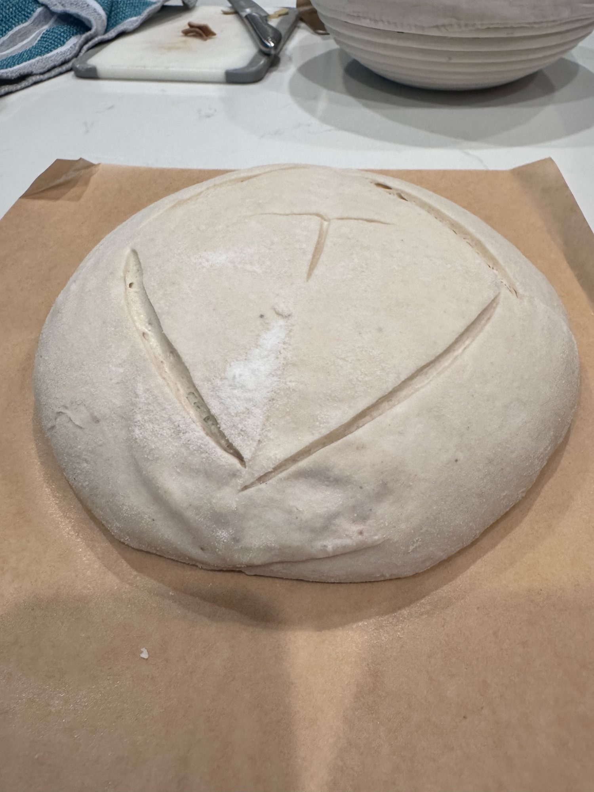
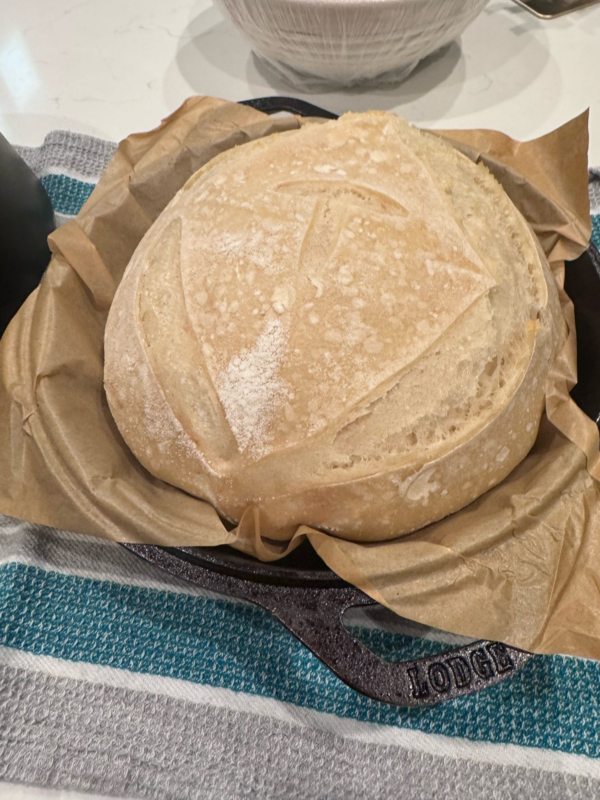
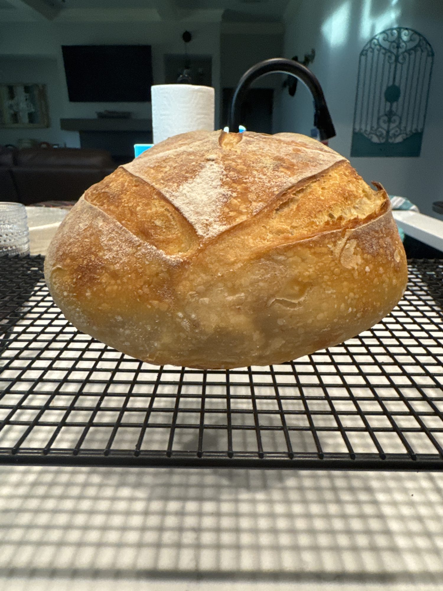
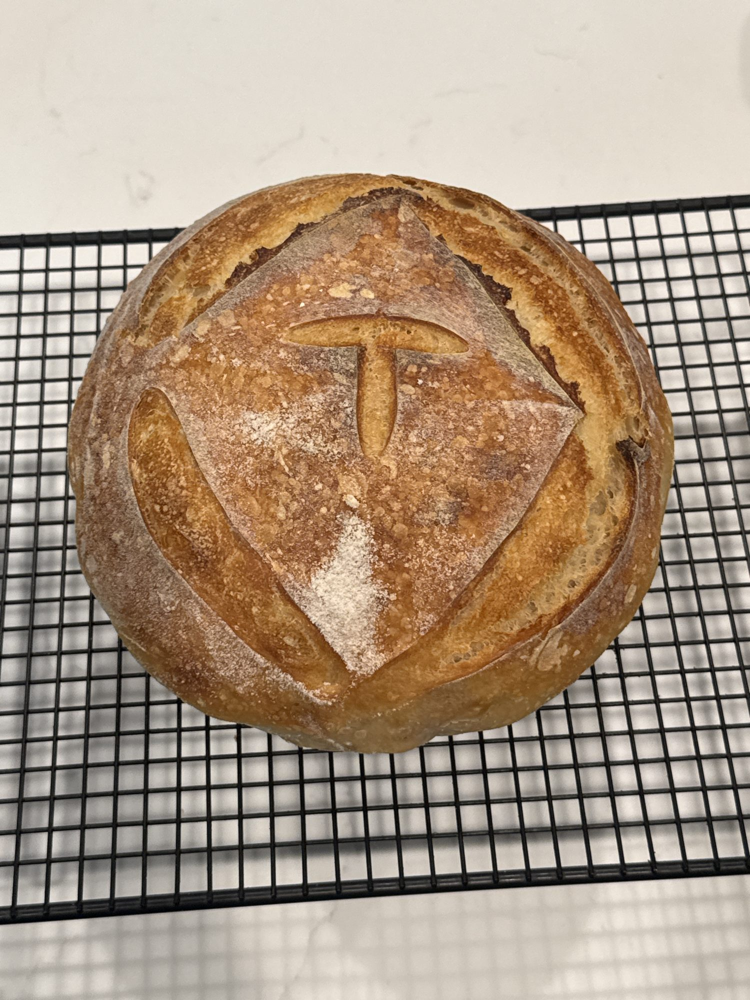

# Bake 008 — Carl.8

**Mixed:** 2026-10-09 · **Baked:** 2026-10-10 · **Status:** ✅ GA

First bake on the converted **90% AP / 10% rye Carl** at 100% hydration (ADR-001).

| Variable | Value |
|----------|-------|
| Formula | 500 flour / 340 water / 100 Carl / 10 salt (~71% true hydration with the 100% Carl) |
| Carl prep | Bedtime feed ~2200 (10/8), 1:4:4, home at 72°F; used ~1140 (10/9) |
| Water temp | **84.6°F** — too warm |
| Mix | **1150** (10/9) |
| Dough temp after mix | **82.6°F** — hot; proofer set to 74°F to cool it |
| Salt | **1235** — dough temp after salt **78°F** |
| Bulk | Brød & Taylor proofer **74°F** with water tray; ~1455 not much rise → raised to **78°F**; ready ~**1610** at ~50–60% rise (dough ~1.6–1.7 L in 4 qt tub, domed/marshmallowy) |
| Folds | **0** |
| Shape | Dough **very slack / marshmallowy** — shaped with strong counter-drag tension |
| Final shape → retard | **1650** (fridge, banneton) |
| Cold proof | ~**16 hr** (1650 → load ~0845) |
| Preheat | Oven + Lodge on at 475°F at **0745** (10/10) |
| Score | Box + T, scored cold from the fridge |
| Load | ~**0845** → 450°F covered, 20 min |
| Finish | Lid off ~**0907** → 425°F uncovered, 25 min; out ~**0932** |
| Crust | Huge oven spring, tall; box + T opened clean with an ear on the side; golden, softer crust (preferred) |
| Baked weight | **815.8 g** (~14% loss from ~950 g dough) — **heaviest loaf so far** (beats Carl.7 808.8 g) |
| Taste | **Banger.** My son ate half the loaf on 10/10 and could tell the difference from the old rye-heavy Carl — likes the 90/10 way better. |

## Notes

The dough came out of bulk very slack and marshmallowy (warm 82.6°F mix, AP-heavy starter, no folds). Strong counter-drag shaping built the surface tension, and the overnight retard firmed it up: tall rise, huge spring, clean score.

**Takeaways**
- **Coil folds next time:** 2 coil folds in the first hour of bulk to build strength before shaping.
- **Water temp / DDT:** 84.6°F water gave an 82.6°F dough. Calculate cooler water to land at 76–78°F.
- Shaping with counter drag rescues a slack dough; a confident, deeper cold score lets it spring.

## Photos

| | |
|---|---|
|  |  |
| Scored (box + T), before bake | After 20 min covered |
|  |  |
| Baked — side | Baked — top |
