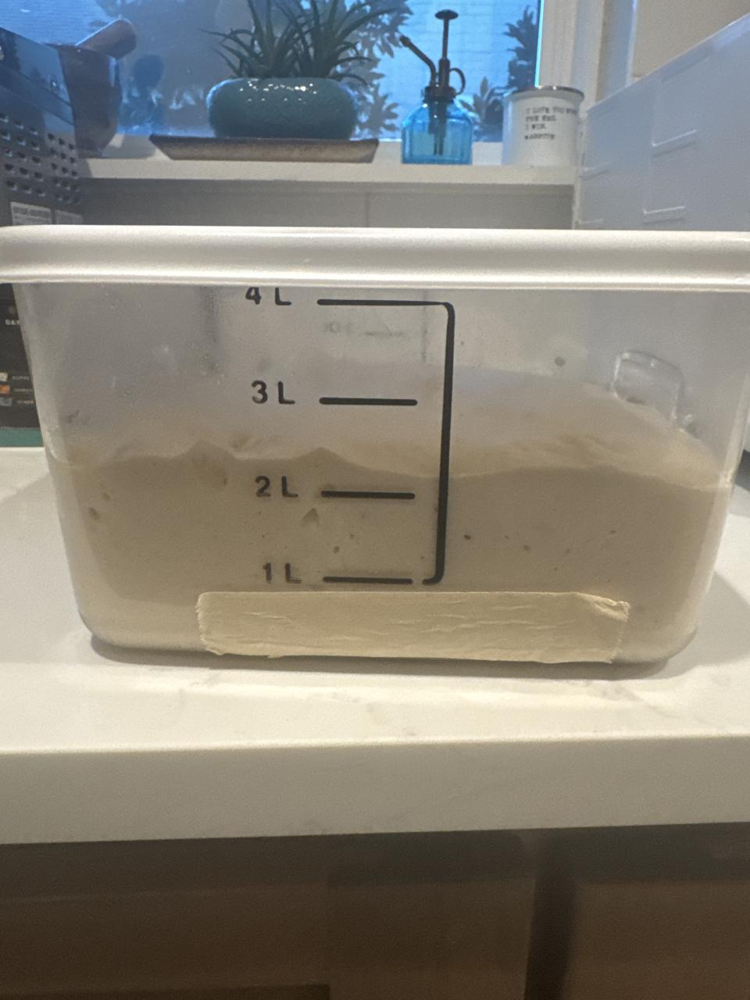
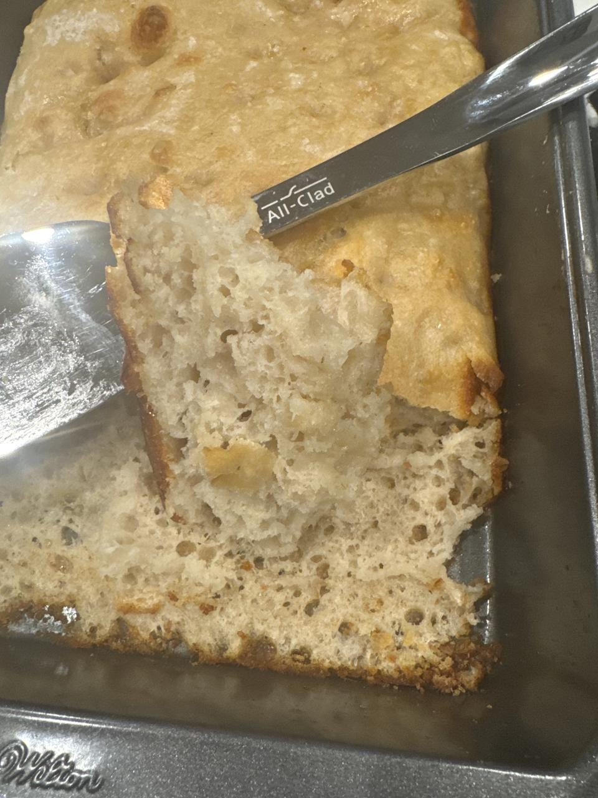

# Bake 009 — Carl.9

**Mixed:** 2026-10-28 · **Baked:** 2026-10-28 (same-night focaccia rescue) · **Status:** 🍞 Rescued

Planned as a baseline boule with coil folds (to fix Carl.8's slack, no-fold dough). A work emergency stretched bulk to ~9 hours, so it became focaccia.

| Variable | Value |
|----------|-------|
| Formula | 500 flour / 340 water / 100 Carl / 10 salt (90/10 Carl at 100%) |
| Carl prep | Out of fridge ~1300 (10/27), 1:1:1 at 78→74°F; bedtime 1:4:4 ~2205 at 72°F; aimed peak ~0700–0900 (10/28) |
| Mix | Finished **0850** (10/28) |
| Dough temp after mix | **73.9°F** — a bit cool |
| Salt | ~**0930** |
| Bulk | Into Brød & Taylor proofer at **72.8°F** dough temp, proofer at **78°F**; check planned ~1430 |
| Folds | Coil folds **planned** at 1000 / 1030 (not confirmed) |
| Bulk check | ~**1743** (work emergency) — **way over-proofed**: ~1 L → ~2.3 L in the 4 L tub, top flattened |
| Rescue | Same-night focaccia in an oiled 9x13 Wilton pan (olive oil only) |
| Bake | **425°F** conventional (no convection), ~**25 min**, until golden |
| Crumb | Golden, open, airy — would have been great |
| Problem | **Stuck to the pan** — olive oil alone wasn't enough |

## Notes

Over-proofed dough isn't scrap. It makes good focaccia.

**Takeaways**
- **Pan:** line with parchment plus oil, or use a heavy 3 tbsp of oil.
- **Check bulk on schedule:** set a Todoist reminder for the bulk check.
- **Over-proofed?** Make focaccia instead of scrapping it.
- Coil folds on a boule are still untested. Try them next bake.

## Photos

| | |
|---|---|
|  |  |
| Over-proofed bulk (~2.3 L) | Focaccia rescue — crumb |

**Update 10/29:** Really, really good. It released from the pan once it cooled.
