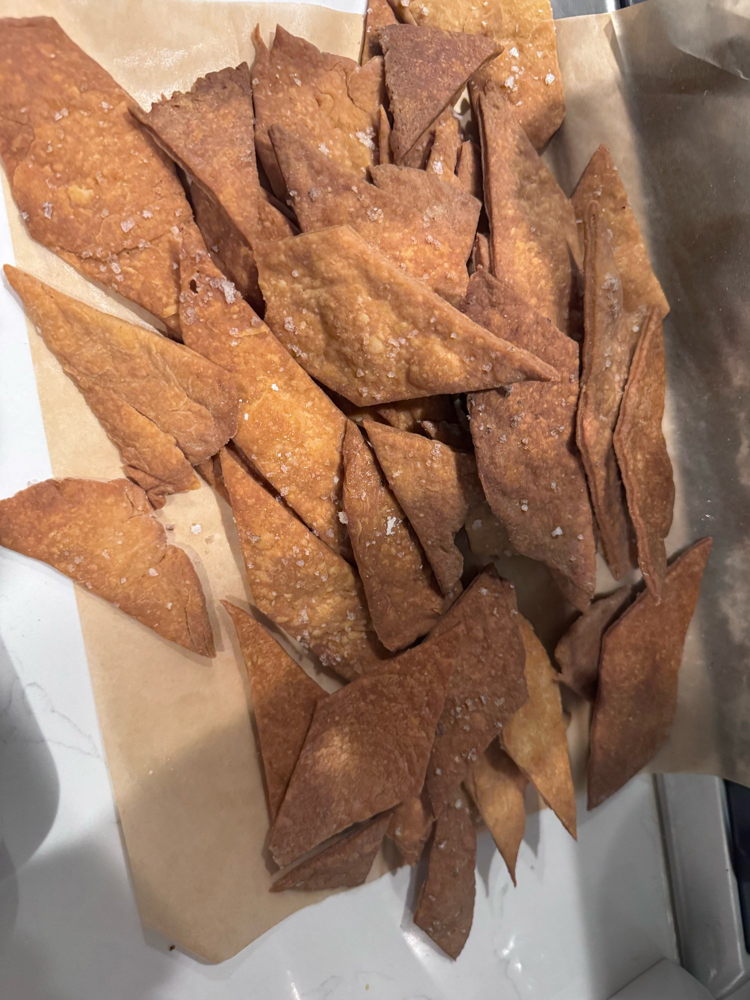
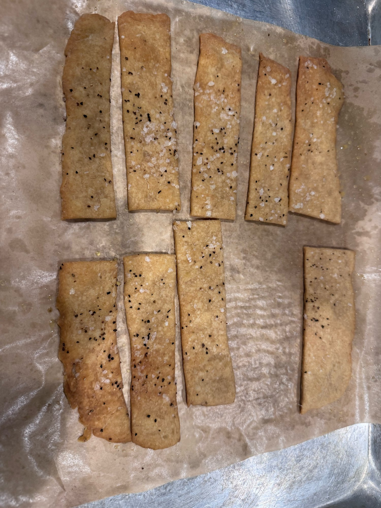

# Rend 005 — Rend.5

**Made:** 2026-10-11 · **Status:** ✅ done

| Variable | Value |
|----------|-------|
| Made | Sourdough discard crackers — olive oil + herb |
| Recipe | King Arthur sourdough cracker dough, made with extra-virgin olive oil instead of butter, plus rosemary/thyme/Italian herbs (450 g discard target) |
| Amounts used | *not recorded* |
| Style A | Thin diamonds/triangles with flaky salt: **crispy**, deep golden |
| Style B | Thicker rectangular strips with flaky salt + black pepper/herbs: **softer** |
| Verdict | Jerrod definitely prefers the **soft** over crispy |

## Lesson

- For soft crackers, roll to **~1/8 in** (not paper-thin) and pull them at **pale golden**.
- Needs a better, wider rolling pin. The current 8 in pin is too narrow; a J.K. Adams 19 in dowel is planned.
- Learned tricks for rolling dough into a square/rectangle from Martin's King Arthur YouTube video (link *not recorded*). The same trick was used for [Rend.6](006.md) shaping.
- Don't roll so thin.
- Prefers soft crackers. Deep golden-brown tastes burnt to Jerrod, so bake only to **pale golden**.
- Used too much flaky salt on top. It tasted great but was too salty. Next time use just a **light pinch per sheet**, since the dough is already salted.

## Photos

